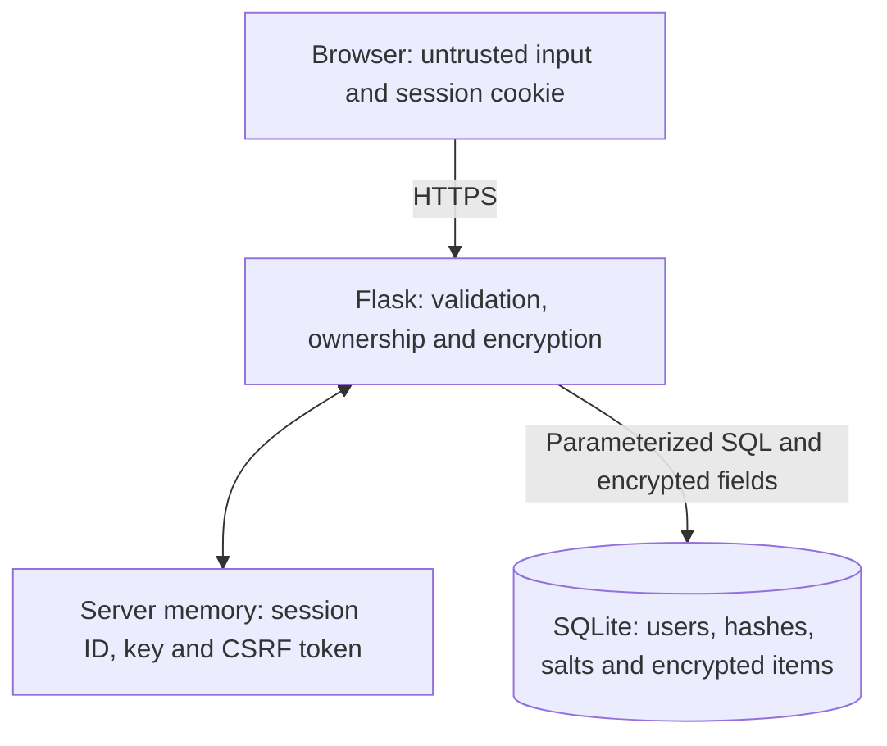

# Secure Password Manager

## 1 Introduction

This project is a web-based password manager for ICS0027 Web Application Security. A registered account can create, view, reveal, edit and delete saved website logins. The objective is to protect those credentials in storage and transit and prevent common attacks against the website. The required features and report structure come from the course project instructions [1].

The application uses Flask, SQLite, Argon2id and AES-GCM. I kept the scope small enough to explain and demonstrate. Folders, sharing, browser extensions and account recovery are outside the scope. The separate Database Basics MySQL project is not imported into this application.

The core application, automated security checks and local HTTPS setup are working. Live Docker checks and manual checks in Brave passed on 14 November 2026. This report explains the implementation, records the attempted attacks and results, and identifies remaining limitations. The source and reproducible tests are available in the repository [2].

## 2 Implementation

The implementation separates browser input, application decisions and stored data. The following sections describe how credentials and requests move through these components.

### 2.1 Architecture and storage

The browser sends forms to one Flask process over HTTPS. Flask validates input, checks the current session and ownership, then encrypts or decrypts records on the server. Figure 1 shows the boundaries between the browser, application and database. The browser is untrusted: hidden inputs, URLs and browser field limits can all be changed.

Figure 1. Application components and trust boundaries.

SQLite keeps two tables. The users table contains id, unique email, password_hash and kdf_salt. The items table contains id, user_id, nonce and encrypted_data. A foreign key connects each item to its owner, and foreign-key enforcement is enabled for each database connection. Titles, login names and saved passwords are encrypted together. Account emails and ownership metadata are readable in the database.

### 2.2 Authentication and encryption

The master password is verified against an Argon2id hash. The password-hashing library generates the hash salt. An independent 16-byte random salt is stored for deriving the vault key. These are different operations: the stored login hash is not used as the encryption key. Argon2id is provided by argon2-cffi [4].

The key derivation in crypto.py uses three iterations, 65,536 KiB of memory, parallelism four and a 32-byte output. AES-256-GCM encrypts the saved fields with a fresh random 12-byte nonce on every save. The account ID is authenticated as associated data. AES-GCM detects modified ciphertext; a failed authentication tag is handled without returning plaintext [5]. It does not prevent replay of a previously valid encrypted record for the same owner.

The derived key stays in the server-side session. SQLite stores hashes, salts, nonces and encrypted records, but no vault key. A forgotten master password cannot be recovered. A compromised running server can still see decrypted fields and active keys.

### 2.3 Sessions and request protection

The browser holds a random session ID; it does not receive the vault key. Login replaces the old session ID, and logout removes its authenticated session. The cookie has Secure, HttpOnly and SameSite=Strict flags. Idle expiry is 15 minutes and absolute expiry is eight hours. Expired sessions are removed when the application next receives a request. Restarting the process clears sessions but preserves SQLite data.

Each POST form includes a CSRF token checked against the server-side session with a constant-time comparison. A missing or incorrect token is rejected before the route action. This protects login, registration, logout and vault operations. Successful authentication does not replace an ownership check: each item lookup includes both its ID and the logged-in account ID.

SQL uses fixed statements with bound values, following the sqlite3 parameter interface [3]. The server checks email structure, master-password length and saved-field length. Requests are limited to 32 KiB. Jinja templates escape text, and the Content Security Policy blocks scripts and framing. Responses use Cache-Control: no-store.

### 2.4 Errors logging and local setup

Unexpected errors return HTTP 500 with a generic message. Expected request errors retain their status. Debug mode is disabled. Audit events are JSON records containing UTC time, event, outcome, account ID when known and source address. Event fields are fixed; submitted form values, passwords, keys, cookies, tokens and exception messages are excluded.

Docker runs the application as a non-root user and publishes its HTTPS port only on 127.0.0.1. A named volume preserves SQLite data. The app uses a temporary self-signed certificate. This is a local course setup, not a public deployment. The README also documents direct Python startup [2].

## 3 Security Analysis

The evaluation combines source review, repeatable automated requests and manual browser actions. Each result is tied to the operation and attempted input rather than treated as a general security guarantee.

### 3.1 Test method and results

Tests use fictional accounts and a new temporary SQLite database per test. The complete unittest run passed 28 executions covering 14 distinct checks; shared base checks run again in both extended suites. The raw output is in docs/security-test-results.txt. Tests use the real password-hashing and encryption libraries, not substitute algorithms.

Table 1 summarizes the recorded attacks and their results. These checks support specific security claims; they are not proof that every possible attack is prevented. The test scripts and live-check instructions are included with the source [2].

Table 1. Security tests and observed results.

| Check | Attempt | Result |
|---|---|---|
| SQL injection | Injection login and SQL-like entry text | Login denied; text remained data |
| XSS | Script markup in saved fields | Escaped; Brave displayed literal text, no popup |
| Ownership | Another account's view/edit/reveal/delete routes | HTTP 404; original entry unchanged |
| CSRF | Missing, foreign or changed token | HTTP 400; no unintended entry |
| Validation | Empty/201-character title and oversized body | Invalid input rejected; HTTP 413 for large body |
| Encryption integrity | Change a ciphertext byte | HTTP 400; no decrypted password |
| Sessions | Old/logout/expired ID and cookie checks | Access denied; flags correct |
| Errors and logs | Simulated database failure and secret markers | Generic HTTP 500; safe audit fields |

### 3.2 Live and browser evidence

The Docker image built and started successfully. A separate HTTPS client with two cookie jars verified registration, login, entry actions, SQL-injection rejection, CSRF rejection and blocked cross-account operations. Login and the saved entry still worked after removing and recreating the container without deleting its volume. JSON audit events were inspected.

I also checked the application in Brave. Registration, login, create, view, reveal and edit worked. The script title appeared literally on both the vault list and entry page without a popup. The owner could open the saved entry, while a second account in a private window saw Not Found for its view and edit URLs.

I changed the hidden csrf field in the add-entry form to wrong using developer tools. Submission returned HTTP 400 with the form-expired message and created no entry. After deleting the sample entry, its URL showed Not Found. After logout, opening /items returned the login page. These manual results are recorded in docs/TEST_RESULTS.md; the automated and live HTTP checks separately confirmed the 404 ownership status.

### 3.3 Remaining limitations

The app has no rate limiting or multi-factor authentication. Online guessing remains possible; adding throttling is a sensible next security improvement. MFA is optional in the project brief [1]. Duplicate registration messages reveal whether an email is registered. These limitations are documented rather than presented as completed protections.

Encryption protects stored credential fields, not a compromised application server. Account emails and entry counts remain visible. The authenticated data identifies the owner, not the individual item, so encryption alone does not prevent substitution or replay within one owner's vault. The application relies on access control to protect ordinary operations.

Sessions are in memory and support a single process. Removing a session drops its key reference but does not guarantee physical erasure from Python memory. The self-signed certificate does not provide public certificate trust. The live test client explicitly accepts that local certificate. Audit records go to the terminal or container logs; durable retention is not configured.

## 4 Conclusion

The application implements the course's required credential storage, authentication, session, CSRF, XSS, SQL-injection, ownership, error-handling and logging controls. Automated, live HTTPS and manual Brave checks passed for the recorded cases. The result is a working local password-manager demonstration with reproducible evidence.

The main lesson is that the protections solve different problems. SQL parameters keep input separate from commands; ownership checks decide whose entry may be accessed; CSRF tokens protect form submission; escaping prevents saved text from becoming browser code. Encryption protects stored fields but cannot protect secrets from the server while it is processing them.

A practical challenge was keeping the design small while collecting useful evidence. Another was Windows test cleanup: a SQLite context manager commits or rolls back but does not close the connection. Explicit closing fixed temporary-file cleanup. A separate HTTPS check was then needed to verify the running container and data persistence. The next improvements would be login throttling and stronger deployment and log-retention arrangements.

## References

[1] A. Ghasempour, ICS0027 Web Application Security Project Instructions, autumn 2026/2027. Sections 1.3-1.5 and 4.1-4.4. Supplied course file Project.pdf.

[2] S. Parra Pinto, Secure Password Manager, source revision d044456. https://github.com/sebasp-9/ics0027. Code: app.py and crypto.py; evidence: tests/ and docs/. Accessed 14 November 2026.

[3] Python Software Foundation, sqlite3, Python 3.12 documentation, parameter binding and connection handling. https://docs.python.org/3.12/library/sqlite3.html. Accessed 14 November 2026.

[4] argon2-cffi, API Reference, version 25.1.0. https://argon2-cffi.readthedocs.io/en/stable/api.html. Accessed 14 November 2026.

[5] Cryptography project, Authenticated encryption, AESGCM API. https://cryptography.io/en/latest/hazmat/primitives/aead/. Accessed 14 November 2026. The implementation pins cryptography 48.0.1; its installed API is the authority for the executed tests.

