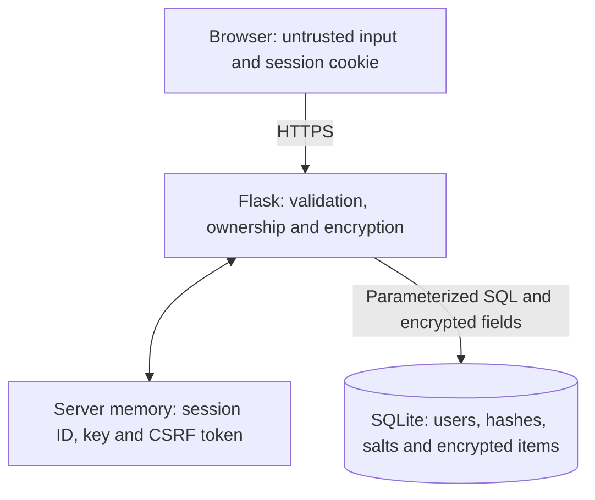

# Secure Password Manager

## 1 Introduction

This project is a web-based password manager built for ICS0027 Web Application Security. A registered user can create, view, reveal, edit, and delete saved website logins. The goal is to protect stored credentials in transit and at rest while defending against common web vulnerabilities such as SQL injection, cross-site scripting (XSS), cross-site request forgery (CSRF), and broken access control [1].

The application uses Flask, SQLite, Argon2id, and AES-256-GCM. I kept the feature set focused on single-user vault items so every route and security check is straightforward to inspect and test. Folders, item sharing, browser extensions, and master-password recovery are outside the project scope.

## 2 Implementation

The application consists of `app.py` (routes, sessions, database queries, input validation, and audit logging), `crypto.py` (password hashing, key derivation, and authenticated encryption), and five Jinja2 HTML templates.

### 2.1 Architecture and storage

The browser sends HTML form requests to a single Flask process over HTTPS. Flask checks the session cookie and CSRF token, validates input, verifies item ownership, and encrypts or decrypts vault items on the server before interacting with SQLite. Figure 1 shows the trust boundaries. Because browser input is untrusted, client-side field attributes (`required`, `maxlength`, hidden inputs) are enforced again on the server.

Figure 1. Application components and trust boundaries.

SQLite uses two tables with foreign-key enforcement (`PRAGMA foreign_keys = ON`) enabled on every connection:
- `users`: `id`, unique `email`, `password_hash`, and `kdf_salt`.
- `items`: `id`, `user_id` (foreign key to `users.id`), `nonce`, and `encrypted_data`.

An item's `title`, `username`, and `password` are serialized together as JSON and encrypted into `encrypted_data`. Account emails and item ownership IDs remain unencrypted so the server can look up accounts and filter items by owner.

### 2.2 Authentication and encryption

Master passwords are verified on login using Argon2id (`PasswordHasher` from `argon2-cffi` [4]). When a user registers, `app.py` stores the Argon2id password hash (which includes its own random salt) and a separate 16-byte random salt (`kdf_salt` from `os.urandom(16)`). If a login attempt submits an unknown email, `app.py` still runs Argon2id verification against a startup `dummy_hash` and returns the same error message (`Incorrect email or master password.`).

After login succeeds, `derive_key()` in `crypto.py` derives a 32-byte encryption key from the master password and `kdf_salt` using raw Argon2id (`time_cost=3`, `memory_cost=65536` KiB, `parallelism=4`). Because login hashing and key derivation use separate salts, the stored `password_hash` cannot be used as the vault key.

Vault items are encrypted and decrypted with AES-256-GCM (`AESGCM` from `cryptography` [5]). Every create or edit generates a fresh 12-byte random nonce (`os.urandom(12)`), which prevents nonce reuse under the same key. The owner's `user_id` is passed as AES-GCM associated data (`str(user_id).encode()`), binding each ciphertext to that user ID. `AESGCM.encrypt()` appends a 16-byte authentication tag to the ciphertext. On decryption, if any byte of the nonce, ciphertext, authentication tag, or associated `user_id` does not match, `AESGCM.decrypt()` raises `InvalidTag` and returns no plaintext.

The derived 32-byte key is held only in the server-side session dictionary while the user is logged in and is never written to SQLite. If a user forgets the master password, stored entries cannot be decrypted.

### 2.3 Sessions and request protection

The browser cookie (`vault_session`) stores only a random URL-safe session ID (`secrets.token_urlsafe(32)`). The corresponding user ID, derived vault key, CSRF token, creation time, and last-seen time stay in server memory (`sessions` in `app.py`). Logging in calls `new_session()`, which deletes the pre-login session and issues a new session ID to prevent session fixation. Logging out replaces the session with an unauthenticated one. Every request checks all stored sessions and removes any session that has been idle for 15 minutes or active for 8 hours.

Every response sets the session cookie with `Secure`, `HttpOnly`, and `SameSite=Strict`, and plain HTTP requests are rejected with HTTP 400 (`request.is_secure`). Every HTML `POST` form includes a hidden `csrf` input. Before any `POST` route handler runs, `load_session()` compares the submitted token with the session's CSRF token using `hmac.compare_digest` and aborts with HTTP 400 if they do not match.

Authentication alone does not grant access to an item. Every item read, reveal, edit, or delete calls `owned_item(item_id)`, which queries `SELECT * FROM items WHERE id = ? AND user_id = ?`. If no row matches both IDs, the server logs `item_access: denied` and returns HTTP 404 (`Not Found`), which avoids revealing whether that item ID exists for another user. `UPDATE` and `DELETE` statements also include `WHERE id = ? AND user_id = ?`.

I used parameterized SQL queries with `?` placeholders throughout `app.py` [3]. Only the account `email` reaches SQLite as user-supplied text; `user_id` and `item_id` are integers, and vault fields (`title`, `username`, `password`) are encrypted into binary ciphertext before `INSERT` or `UPDATE`. The server validates email format, master-password length (12–128 characters), and item field lengths (1–200 characters), and rejects request bodies over 32 KiB with HTTP 413.

Jinja2 templates automatically HTML-escape rendered variables (`{{ ... }}`), turning characters such as `<` and `>` into `&lt;` and `&gt;`. Every response also sets `Content-Security-Policy: default-src 'self'; script-src 'none'; style-src 'self'; frame-ancestors 'none'; base-uri 'none'; form-action 'self'`, `X-Content-Type-Options: nosniff`, `Referrer-Policy: no-referrer`, and `Cache-Control: no-store`.

### 2.4 Error handling, logging, and Docker setup

The global error handler `safe_error()` catches unexpected exceptions, logs `server_error: failed`, and returns a generic HTTP 500 message (`Something went wrong. Please try again later.`) without stack traces or internal paths. Expected HTTP errors (`400`, `404`, `413`) keep their status codes, and Flask debug mode is disabled (`debug=False`).

The `audit()` function writes structured JSON lines to the `vault.audit` logger with five fixed keys: `time` (UTC ISO-8601), `event`, `outcome`, `user_id`, and `source`. Form inputs, passwords, derived keys, session IDs, CSRF tokens, and exception messages are never passed to `audit()`.

The `Dockerfile` runs Python 3.12 as a non-root user (`app`, UID 10001), and `compose.yaml` binds port `5000` only to `127.0.0.1` while persisting `/app/instance` in the `vault-data` volume. The development server uses a temporary self-signed TLS certificate (`ssl_context='adhoc'`) and runs single-threaded (`threaded=False`) so the in-memory `sessions` dictionary is not accessed concurrently.

## 3 Security Analysis

I tested the application using automated Python `unittest` suites (`tests/test_security.py`, `tests/test_sessions.py`, and `tests/test_logging.py`), supplemented by the live Docker HTTPS and manual Brave checks recorded on 14 November 2026.

### 3.1 Automated test method and results

Each unit test creates a fresh temporary SQLite database and registers two disposable accounts (`alice@example.test` and `bob@example.test`) using the real Argon2id and AES-256-GCM implementations. All **14 automated tests passed** (raw output in `docs/security-test-results.txt`). Table 1 summarizes the threats tested, the attack vectors attempted, how each is mitigated, and the observed results.

Table 1. Security test cases, mitigations, and results.

| Threat | Attack attempted | Mitigation | Result |
|---|---|---|---|
| SQL injection | Submit `' OR 1=1 --`, `alice@example.test' --`, and `'; DROP TABLE users; --` as the login email with a valid master password | Parameterized SQLite queries (`?` placeholders) in `app.py` | Login denied (`200`); `users` table unchanged |
| Vault-data round-trip | Save, edit, reveal, and delete `Robert'); DROP TABLE items; --` and `' OR 1=1 --` in item fields | Item fields are JSON-encoded and encrypted with AES-256-GCM before SQL storage | Stored and shown as literal text; edit and delete succeed |
| Stored XSS | Store `` in `title`, `username`, and `password` | Jinja2 HTML auto-escaping and `Content-Security-Policy` (`script-src 'none'`) | Escaped as `&lt;script&gt;` on list, view, edit, and reveal pages; CSP header present |
| Cross-user access (IDOR) | Bob requests Alice's view/edit pages (`GET`) and reveal/edit/delete routes (`POST`) | `owned_item()` checks `WHERE id = ? AND user_id = ?` and aborts with `404` | All cross-user requests return `404`; Alice's entry is unchanged |
| CSRF | Send `POST` requests with a missing token or Bob's token to all seven `POST` routes | Session-bound CSRF token verified with `hmac.compare_digest` in `load_session()`, plus `SameSite=Strict` cookie | Rejected with `400`; no account or item changes occur |
| Input validation | Submit empty or 201-character title; send a 40 KB request body | Server length checks (`1..200` chars) and `MAX_CONTENT_LENGTH = 32 * 1024` | Invalid item rejected; oversized body returns `413` |
| Ciphertext tampering | Flip one bit of `encrypted_data` in SQLite and request `/reveal` | AES-256-GCM tag verification in `decrypt_item()` with `user_id` as associated data | Returns `400` without plaintext or traceback; logs `decrypt: failed` |
| Session security | Check session ID rotation on login, replay logged-out cookie, exceed 15-minute idle or 8-hour total expiry, check cookie flags, and request `http://` | `new_session()` and `load_session()` manage rotation and expiry; `protect_response()` sets `Secure`, `HttpOnly`, `SameSite=Strict` | Old/expired sessions redirect (`302`) to `/login`; cookie flags present; plain HTTP returns `400` |
| Errors and logging | Trigger actions/denials containing secret markers and simulate `sqlite3.OperationalError('SECRET database path')` | `safe_error()` returns generic `500`; `audit()` logs only fixed JSON fields (`time`, `event`, `outcome`, `user_id`, `source`) | Generic `500` returned; secret markers, passwords, tokens, and exception text absent from logs |

### 3.2 Live HTTPS and browser evidence

On 14 November 2026, I built and started the Docker container and ran `tests/verify_https.py` against `https://127.0.0.1:5000` using two independent cookie jars. Registration, login, item creation/reveal/edit/delete, SQL-injection login rejection, forged-CSRF rejection (`400`), and cross-user access denial (`404`) all passed, and saved items persisted across `docker compose down` and `docker compose up -d`.

On the same date, I tested the application manually in Brave (`docs/TEST_RESULTS.md`). Saving `` as an entry title displayed literal text on the vault list and item view pages without executing script code. Opening that entry's view and `/edit` URLs from a second account in a private window returned `Not Found` (`404`). Editing the hidden `csrf` input to `wrong` in developer tools before submitting the new-entry form returned HTTP 400 and created no entry.

### 3.3 Remaining limitations

- **Authentication and registration:** There is no login rate limiting or multi-factor authentication (MFA is optional in the project brief [1]), and the registration form indicates when an email address is already taken.
- **Server-side encryption scope:** AES-256-GCM protects stored item fields in the SQLite file, but the running server holds active session keys in memory and sees plaintext during requests. In addition, associated data binds each ciphertext to `user_id` rather than `item_id`, so database-level tampering could still replace one of a user's encrypted items with an older ciphertext from the same user.
- **Single-process runtime and logs:** Sessions live in process memory (clearing on restart), and JSON audit events are written to standard output rather than external log storage.

This is a local course project; production deployment would need additions such as a trusted certificate and rate limiting.

## 4 Conclusion

The password manager implements Argon2id password hashing and key derivation, AES-256-GCM vault encryption, server-side sessions, CSRF tokens, per-user ownership checks, parameterized SQL queries, output escaping with CSP, generic error handling, and fixed-field JSON audit logging. Automated unit tests (14 tests) together with the recorded Docker HTTPS and browser checks verify these controls against concrete attack payloads.

Building and testing the project showed how each defence handles a distinct boundary: parameterized SQL separates query structure from data on login, `WHERE id = ? AND user_id = ?` enforces item ownership after login, session-bound CSRF tokens authenticate form submissions, and HTML escaping with CSP stops stored text from running as JavaScript. One practical testing issue on Windows was that `sqlite3` connections used as context managers commit or roll back transactions without closing the file handle; wrapping test database connections in `contextlib.closing()` allowed temporary SQLite files to be deleted cleanly after each test.

## References

[1] A. Ghasempour, ICS0027 Web Application Security Project Instructions, autumn 2026/2027. Sections 1.3–1.5 and 4.1–4.4. Supplied course file `Project.pdf`.

[2] S. Parra Pinto, Secure Password Manager. https://github.com/sebasp-9/ics0027. Code: `app.py` and `crypto.py`; evidence: `tests/` and `docs/`.

[3] Python Software Foundation, `sqlite3` — DB-API 2.0 interface for SQLite databases, Python 3.12 documentation. https://docs.python.org/3.12/library/sqlite3.html.

[4] `argon2-cffi`, API Reference, version 25.1.0. https://argon2-cffi.readthedocs.io/en/stable/api.html.

[5] Python Cryptographic Authority, Authenticated encryption (`AESGCM`), `cryptography` 48.0.1 documentation. https://cryptography.io/en/latest/hazmat/primitives/aead/.

